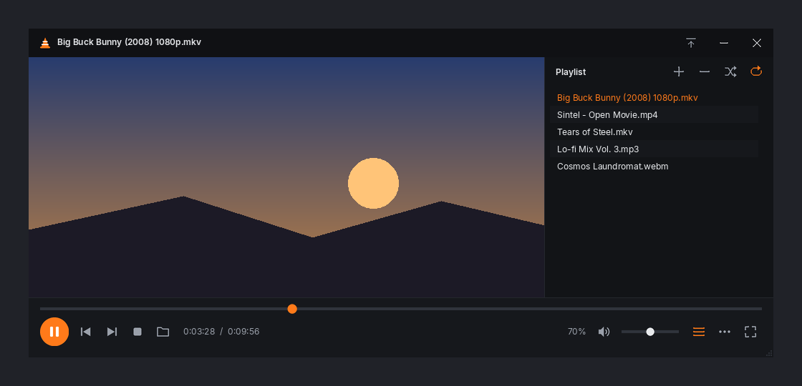
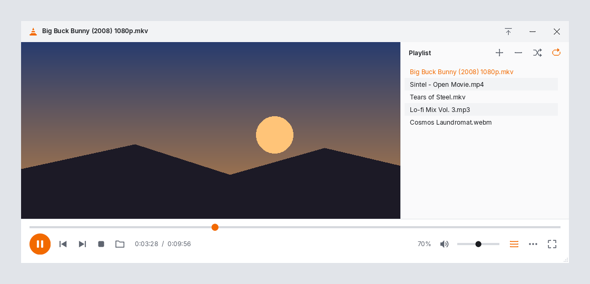

# Conekit

Modern, clean skins for VLC media player. Fewer buttons, bigger targets, and a layout that resizes properly.



| Dark | Light |
|---|---|
|  |  |

## What's in it

- **Main window**: title bar with keep-on-top, minimize, and close; full-width seek bar; play/pause, previous, next, stop, and open; time display; mute, volume, playlist toggle, a **⋯** button that opens VLC's full menu (subtitles, audio tracks, settings); and fullscreen.
- **Playlist window**: add, remove, shuffle, and repeat. Toggle it from the main window.
- **Fullscreen controller**: a compact bar that appears in fullscreen mode.
- Resizable windows (drag the bottom-right corner) and the Inter typeface.
- Two variants: **Dark** and **Light**, both with a traffic-cone orange accent.

## Install (Windows / Linux, VLC 3.x)

1. Download the skins from the [latest release](../../releases/latest). Get `Conekit-Dark.vlt` and/or `Conekit-Light.vlt`.
   - On Windows, you can also download `install-windows.bat`, put it in the same folder as the `.vlt` files, and double-click it. It copies the skins into VLC's skins folder.
2. Open VLC, then go to **Tools → Preferences → Interface**.
3. Select **Use custom skin**, click **Choose…**, and pick the `.vlt` file.
4. Click **Save** and restart VLC.

To go back, right-click anywhere in the skin, then choose **Interface → Choose skin → Use native style** (or reset the Interface preference).

> macOS VLC doesn't support custom skins. VLC 4 uses a new interface that doesn't load `.vlt` skins.

## Build / customize

All icons, backgrounds, and the `theme.xml` are generated by one script, so you can change the colors and rebuild:

```bash
pip install pillow
python build.py
```

The output goes to `dist/` (the skins) and `preview/` (the screenshots).

- **New color variant**: add an entry to `PALETTES` in `build.py`.
- **Layout and sizes**: change the constants (`W`, `H`, `TB`, `BAR`, …) and `Theme.build()`.
- **Icons**: edit the `ic_*` functions. They're simple vector shapes drawn at 4× and downsampled.

The generated XML validates against VLC's official `skin.dtd` (skins2 v2.0).

## License

Code and artwork: MIT. Inter font: SIL Open Font License 1.1 (`src/fonts/OFL-Inter.txt`).
VLC and the VLC cone are trademarks of VideoLAN. Conekit is an unofficial community project.
